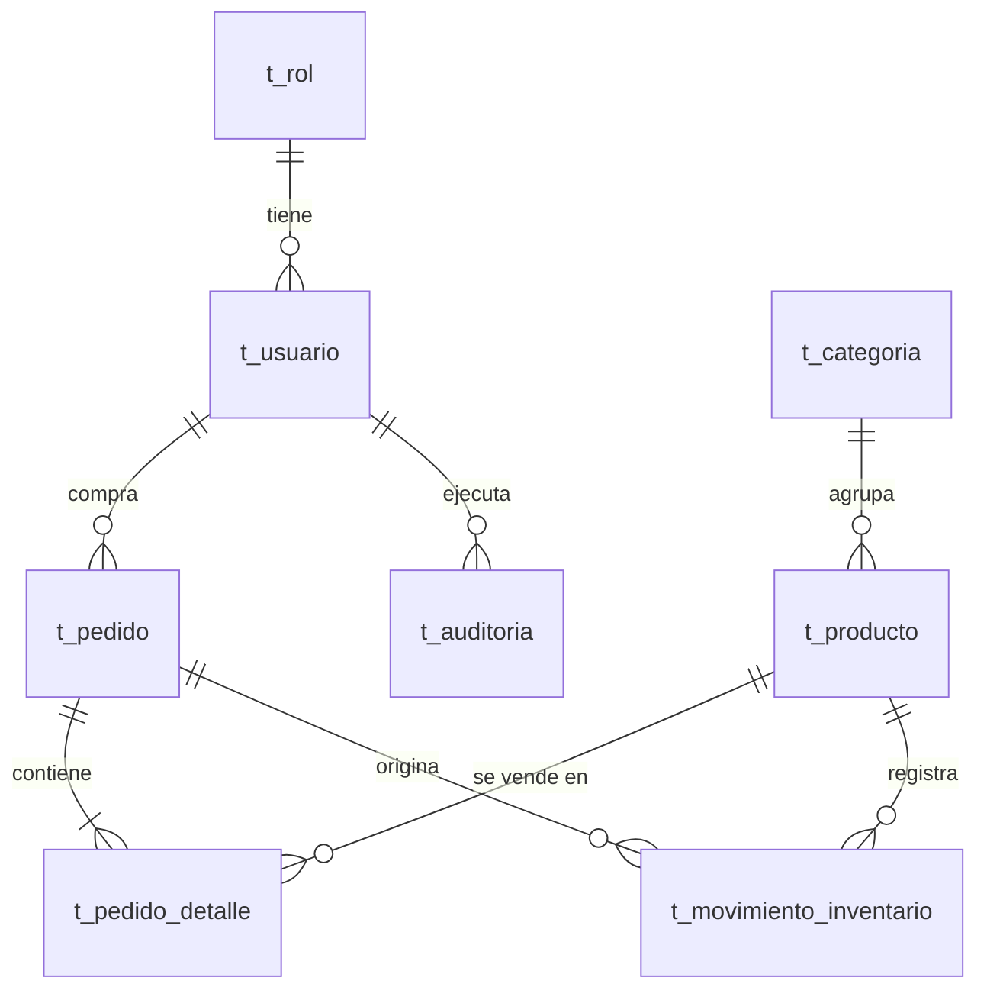

# Plan de base de datos (Supabase / PostgreSQL)

Estado: **propuesta para aprobar. Todavía no se ha cambiado código.**

## 1. Convenciones

| Regla | Detalle |
|---|---|
| Prefijo | Todas las tablas empiezan por `t_` (ej. `t_usuario`). Nombres en español, singular, minúsculas con `_`. |
| Clave primaria | `id BIGINT GENERATED ALWAYS AS IDENTITY`. Es la que usan las claves foráneas internas. |
| Identificador público | `uuid UUID NOT NULL UNIQUE DEFAULT gen_random_uuid()`. Es lo que ve la API y el navegador; así no se exponen números consecutivos. |
| Auditoría | Las mismas 6 columnas en **todas** las tablas (ver abajo). |
| Dinero | `NUMERIC(12,2)`, nunca `float`. |
| Fechas | `TIMESTAMPTZ` (UTC). |
| Borrado | **Lógico** (`deleted_at`): no se borran filas, se marcan. Los índices únicos son parciales (`WHERE deleted_at IS NULL`). |
| Integridad | Claves foráneas con `ON DELETE RESTRICT`, `CHECK` para precios, stock y cantidades. |

### Columnas estándar (en todas las tablas)

```sql
id          BIGINT GENERATED ALWAYS AS IDENTITY PRIMARY KEY,
uuid        UUID        NOT NULL DEFAULT gen_random_uuid() UNIQUE,
created_at  TIMESTAMPTZ NOT NULL DEFAULT now(),
created_by  BIGINT      REFERENCES t_usuario(id),   -- NULL = sistema / seed
updated_at  TIMESTAMPTZ NOT NULL DEFAULT now(),
updated_by  BIGINT      REFERENCES t_usuario(id),
deleted_at  TIMESTAMPTZ,                             -- NULL = registro vigente
deleted_by  BIGINT      REFERENCES t_usuario(id)
```

`updated_at` y `updated_by` los mantiene un trigger. `created_by`/`updated_by` salen del usuario autenticado: el backend lo informa en cada transacción con `set_config('app.user_id', ..., true)` y el trigger lo lee.

## 2. Tablas

### Diagrama



### t_rol: catálogo de roles
| Columna | Tipo | Notas |
|---|---|---|
| codigo | VARCHAR(20) | `ADMIN`, `CLIENTE`. Único. |
| nombre | VARCHAR(60) | |
| descripcion | VARCHAR(200) | |

### t_usuario: cuentas de clientes y administradores
| Columna | Tipo | Notas |
|---|---|---|
| rol_id | BIGINT FK → t_rol | |
| nombre | VARCHAR(120) | |
| email | VARCHAR(255) | Único (sin distinguir mayúsculas, solo vigentes). |
| password_hash | VARCHAR(255) | scrypt, como ahora. |
| activo | BOOLEAN | Permite bloquear sin borrar. |
| ultimo_login_at | TIMESTAMPTZ | |

### t_categoria
| Columna | Tipo | Notas |
|---|---|---|
| nombre | VARCHAR(60) | Único. Hoy es un texto suelto dentro del producto. |
| descripcion | VARCHAR(200) | |

### t_producto
| Columna | Tipo | Notas |
|---|---|---|
| categoria_id | BIGINT FK → t_categoria | |
| sku | VARCHAR(40) | Único. |
| nombre | VARCHAR(160) | |
| descripcion | VARCHAR(500) | |
| precio | NUMERIC(12,2) | `CHECK (precio > 0)` |
| stock | INTEGER | `CHECK (stock >= 0)`. Se descuenta con `UPDATE ... WHERE stock >= n` (atómico, como hoy). |
| activo | BOOLEAN | Visible en la tienda. |

### t_pedido: cabecera de la compra (el recibo)
| Columna | Tipo | Notas |
|---|---|---|
| numero | VARCHAR(40) | Único. `V-YYYYMMDD-XXXXXX`. |
| usuario_id | BIGINT FK → t_usuario | El cliente que compra. |
| estado | VARCHAR(20) | `CHECK IN ('PAGADO','ANULADO')`. Por ahora todo nace `PAGADO`. |
| subtotal | NUMERIC(12,2) | |
| tasa_impuesto | NUMERIC(5,4) | Foto de la tasa usada (0.2100), por si cambia después. |
| impuesto | NUMERIC(12,2) | |
| total | NUMERIC(12,2) | |
| motor_recibo | VARCHAR(10) | `v1` / `v2`. **Interno**: solo lo ve el administrador. |
| tiempo_proceso_seg | NUMERIC(10,3) | Lo que tardó en generarse el recibo (base de la comparación V1/V2). |

### t_pedido_detalle: líneas del pedido
| Columna | Tipo | Notas |
|---|---|---|
| pedido_id | BIGINT FK → t_pedido | |
| producto_id | BIGINT FK → t_producto | |
| nombre_producto | VARCHAR(160) | Foto del nombre al momento de la compra. |
| precio_unitario | NUMERIC(12,2) | Foto del precio al momento de la compra. |
| cantidad | INTEGER | `CHECK (cantidad > 0)` |
| total_linea | NUMERIC(12,2) | |

### t_movimiento_inventario: historial de stock (kardex)
Cada cambio de stock deja una fila: así se puede explicar cualquier diferencia.
| Columna | Tipo | Notas |
|---|---|---|
| producto_id | BIGINT FK → t_producto | |
| pedido_id | BIGINT FK → t_pedido | Solo cuando el movimiento viene de una venta. |
| tipo | VARCHAR(20) | `VENTA`, `INGRESO`, `AJUSTE`, `ANULACION`. |
| cantidad | INTEGER | Negativa = sale, positiva = entra. |
| stock_resultante | INTEGER | Stock después del movimiento. |
| motivo | VARCHAR(200) | |

### t_auditoria: registro de cambios (solo se inserta)
Lo llena un trigger genérico en las tablas de negocio; nadie lo edita a mano.
| Columna | Tipo | Notas |
|---|---|---|
| tabla | VARCHAR(60) | |
| registro_uuid | UUID | Fila afectada. |
| accion | VARCHAR(10) | `INSERT`, `UPDATE`, `DELETE`. |
| datos_antes | JSONB | |
| datos_despues | JSONB | Nunca incluye `password_hash`. |
| usuario_id | BIGINT FK → t_usuario | Quién lo hizo. |

Lleva también las columnas estándar por uniformidad, aunque `updated_*` y `deleted_*` no se usarán.

### t_parametro (opcional)
Configuración editable sin redesplegar: `TASA_IVA`, `MOTOR_RECIBO` (v1/v2). Columnas: `clave` (única), `valor`, `descripcion`. Permitiría cambiar el motor de recibo desde la base en vez de la variable de entorno. **Solo si lo quieres**; si no, se queda en `RECEIPT_ENGINE`.

## 3. Índices principales
- Únicos parciales (solo filas vigentes): `lower(t_usuario.email)`, `t_producto.sku`, `t_categoria.nombre`, `t_pedido.numero`.
- Índices en todas las claves foráneas.
- `t_pedido(created_at DESC)` para el listado de ventas y `t_pedido(usuario_id, created_at DESC)` para "Mis pedidos".
- `t_auditoria(tabla, registro_uuid)`.

## 4. Seguridad en Supabase
Supabase expone por defecto el esquema `public` por una API REST. Para que nadie lea las tablas saltándose el backend:
- **RLS activado en todas las tablas, sin políticas** para `anon` y `authenticated`. Solo el backend entra, con la conexión directa a Postgres.
- La cadena de conexión va en `DATABASE_URL` (variable de entorno, nunca en el repositorio).
- En Vercel hay que usar el **pooler de Supabase (modo transacción, puerto 6543)**; con psycopg requiere desactivar los prepared statements (`prepare_threshold=None`).

## 5. Cambios en el código (después de aprobar)
1. **Migraciones**: `supabase/migrations/0001_esquema.sql` con tablas, índices, triggers y RLS. Reemplaza el `create_all` y el parche de columnas actual.
2. **Modelos**: un `AuditedEntity` base (id, uuid, columnas de auditoría) del que heredan todas las entidades; tablas renombradas a `t_*`.
3. **Repositorios/servicios**: filtro automático de borrados lógicos, `set_config('app.user_id')` por transacción, y registro de movimientos de inventario al comprar.
4. **API y frontend**: los identificadores pasan de número a **uuid** (`product_id`, rutas de admin).
5. **Seed**: roles, categorías, productos, administrador y cliente de prueba.
6. **Pruebas**: se mantienen con SQLite para ser rápidas; se añade una corrida contra Postgres para probar triggers y restricciones.
7. **Documentación**: README y `scripts/README.md`.

## 6. Decisiones que necesito de ti
1. **Nombres en español** (`t_usuario`, `t_pedido`...) ¿o prefieres inglés (`t_user`, `t_order`...)?
2. **Autenticación**: mantener la actual (tabla `t_usuario` + JWT propio, es lo que recomiendo: menos cambios) o migrar a Supabase Auth.
3. **Borrado lógico** (recomendado) o borrado real.
4. ¿Incluyo `t_movimiento_inventario` y `t_parametro`, o dejamos solo las 7 tablas base?
5. Interrumpiste el pedido de **"liberar el login para usarlo sin la BD"**. ¿Sigue vigente (por ejemplo, un modo demo si la base no responde) o lo reemplaza este cambio a Supabase?
